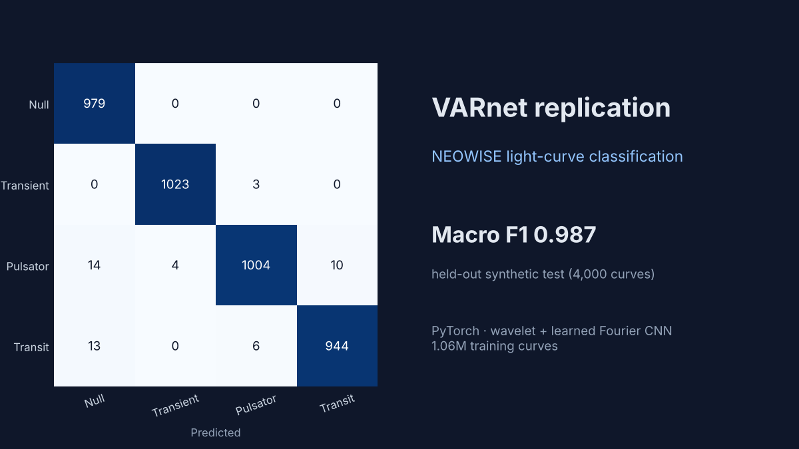

# Classifying Variable Stars with Deep Learning: A VARnet Replication

**In one sentence:** I rebuilt a published deep learning model from the research paper alone (no code was released), trained it on 1 million examples, and checked whether it works as described.



| | |
|---|---|
| **Paper** | Paz (2024), *The Astronomical Journal* 168:241 ([DOI](https://doi.org/10.3847/1538-3881/ad7fe6)) |
| **Task** | Sort a star's brightness-over-time record into 4 types: constant, one-off flare, pulsating, or eclipsing |
| **Result** | **Macro F1 0.987** on 4,000 held-out test curves (paper: 0.914 on real telescope data, see note below) |
| **Scale** | 1,058,304 training curves, trained on a laptop GPU (Apple M-series) |
| **Skills shown** | PyTorch · CNNs · signal processing (wavelets, Fourier transforms) · synthetic data generation · model evaluation (precision, recall, F1, confusion matrix) · error analysis |
| **Time to run** | About 30–60 minutes on a recent laptop |

---

## The problem, in plain English

NASA's NEOWISE telescope recorded the brightness of millions of stars over 10 years. Most stars stay constant, but some flicker, flare up, or dim on a schedule, and finding those "variable" stars by hand is impossible at this scale. The paper proposes **VARnet**, a fast neural network that sorts each star's light curve into one of four classes. I wanted to know whether the method holds up when someone else builds it from the paper.

## What I did

1. **Wrote a data generator** that creates realistic fake light curves for all four classes, following the paper's step-by-step algorithms. New curves are made for every batch, so the model never sees the same example twice.
2. **Built the model in PyTorch**: convolution layers, a wavelet transform to separate smooth trends from noise, and a "learned Fourier" layer that turns any-length input into a fixed-size summary.
3. **Trained it at the paper's full scale**: 53 rounds of 20,000 new curves, using the paper's optimizer settings.
4. **Evaluated it honestly**: held-out test data, macro-averaged metrics, confusion matrices, and a look at every kind of mistake.
5. **Repeated the run** on a second machine (CPU) to confirm the result: F1 0.985 vs. 0.987.

## Results

| Metric (macro average) | My replication | Paper |
|---|---|---|
| F1, 4 classes | **0.987** | 0.914 |
| Accuracy, 4 classes | **98.8%** | 92.2% |
| F1, variable vs. not variable | **0.991** | 0.974 |

> **Why my score is higher, and why that's not "beating" the paper:** my test curves come from the same generator used for training, which is easier than the real telescope data the paper tested on. These results show the reimplementation is correct and learns as described. A test on real stars is the next step (see *Technical details*).

## What I found

- **It works as described.** Built from the text alone, the model separates all four classes, and none of the 979 constant stars was mistaken for a variable one.
- **The mistakes match the paper's.** The few errors are faint variable stars read as constant, and pulsating stars confused with eclipsing ones, which is the same weakness the paper reports.
- **Confident doesn't always mean correct.** Some wrong answers come with 95–100% confidence. That matters because the paper ranks candidate stars by confidence.
- **One layer matters less than it looks.** The "learned" Fourier frequencies barely moved during training (about ±3%), so most of that layer's value comes from its fixed structure.

## Key charts

| Training progress | Where the model is right and wrong |
|---|---|
|  |  |

| Accuracy vs. signal strength | Examples it got wrong |
|---|---|
|  |  |

<details>
<summary><b>More charts</b> (data, preprocessing, wavelets, frequencies, confidence)</summary>

**Example training curves for each class**


**Preprocessing:** raw brightness, then median/IQR scaling, then arcsinh compression (the model's actual input)


**Wavelet decomposition:** smooth trend vs. fast changes


**Learned Fourier frequencies:** starting vs. final positions


**Prediction confidence** (log scale): right vs. wrong answers


**Variable vs. not variable**


</details>

## Run it yourself

```bash
pip install -r requirements.txt
python train.py --paper-scale   # full run: 1.06M curves (use python train.py for a quick version)
python visualize.py             # makes the charts in results/figures/
```

It uses an Apple-silicon or NVIDIA GPU if one is available, and otherwise the CPU.

## What's in this repository

| Path | Contents |
|---|---|
| `varnet/generator.py` | Synthetic light-curve generator (the paper's Algorithms 2–6) |
| `varnet/data.py` | Preprocessing and batching |
| `varnet/model.py` | The VARnet model in PyTorch |
| `train.py` | Training and evaluation |
| `visualize.py` | Explanatory charts |
| `results/` | Metrics, training history, trained model, charts |

<details>
<summary><b>Technical details</b> (architecture, settings, assumptions, next steps)</summary>

### Architecture (paper Figure 8)
- **Input:** each curve becomes a 3 × T tensor (brightness, uncertainty, time), zero-padded per batch.
- **Phase 1:** Conv1d 3→16→24→4, then a single-level bior2.2 discrete wavelet transform into approximation and detail (4 × T/2 each). Both are repeated back to length T and concatenated with the input to make 11 channels, followed by Conv1d 11→32→16→4.
- **Phase 2:** the finite-embedding Fourier transform, a DFT evaluated at 700 learned frequency positions, gives a fixed-length vector for any input length. Then Conv1d 4→24→12→1 and fully connected layers 700→350→175→4.

### Preprocessing (paper Eqs. 2–5)
- flux → `arcsinh((flux − median) / IQR)`
- uncertainty → `arcsinh(err / IQR)`
- time → `(t − t₀) / 4000`

### Training
AdamW, learning rate 8.5e-5, weight decay 10^-5.5, cross-entropy loss. The best epoch is chosen by validation macro F1, and the test set is 4,000 held-out curves.

### Assumptions where the paper is not specific
All of these are marked `ASSUMPTION` in the code.
- **Time sampling:** the printed pseudocode swaps the 0.115-day and 170-day branches, so the code follows the text instead.
- **Magnitude weighting:** magnitudes are drawn toward the dim end (`m = 16 − 10u²`), and the noise level is drawn log-uniformly.
- **Signal-to-noise:** a minimum signal-to-noise (3σ/flux ≤ 0.5) is applied to every class, so variable stars stay detectable and no class can be identified from noise level alone.
- **Shapes:** transient time is measured as a fraction of the event duration. Transit troughs span 2–15% of the period. Pulsator envelopes have width 20–400, with peaks of random sign.
- **Model details:** convolution kernel size 5, and the Fourier layer outputs the magnitude of the complex projection.

### Inference speed
Not reported. The first run's timer stopped before the Apple GPU finished its work, so its figure is unreliable. `train.py` now waits for the GPU before timing.

### Next step: real NEOWISE stars
The paper's test set has 48 eclipsing binaries, 49 pulsators and 34 transients from public catalogs, plus 100 constant stars. To reproduce that test:
1. Rebuild a catalog in the same proportions.
2. Download W1 brightness data from NASA/IPAC IRSA (for example with `astroquery.ipac.irsa`).
3. Convert magnitudes to flux (paper Eq. 1) and preprocess with `varnet.data.preprocess`.
4. Evaluate the saved model.

</details>

## Credit

The original method and paper are by **M. Paz (2024)**, *The Astronomical Journal* 168:241, published under the CC BY 4.0 license. All code in this repository is my independent reimplementation.

**Author:** Yoga Sundaram Rama Swamy · [Portfolio](https://yogasundaram95.github.io/yoga_sundaram/) · [LinkedIn](https://linkedin.com/in/yogasundaram)
