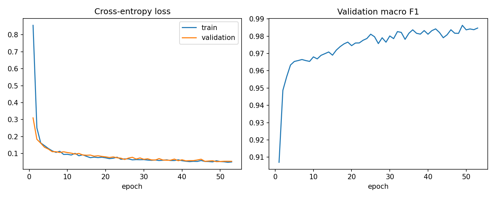
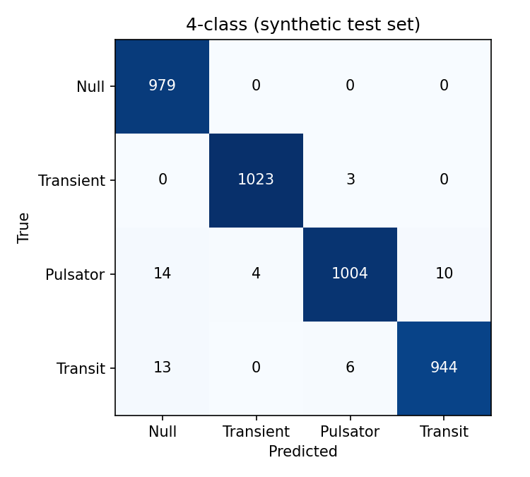
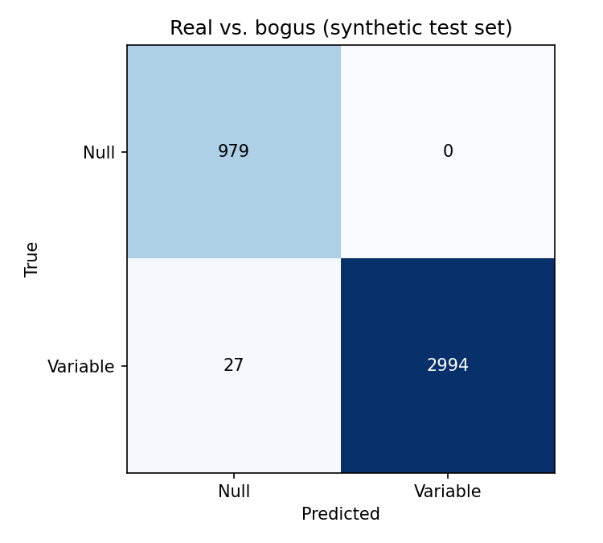
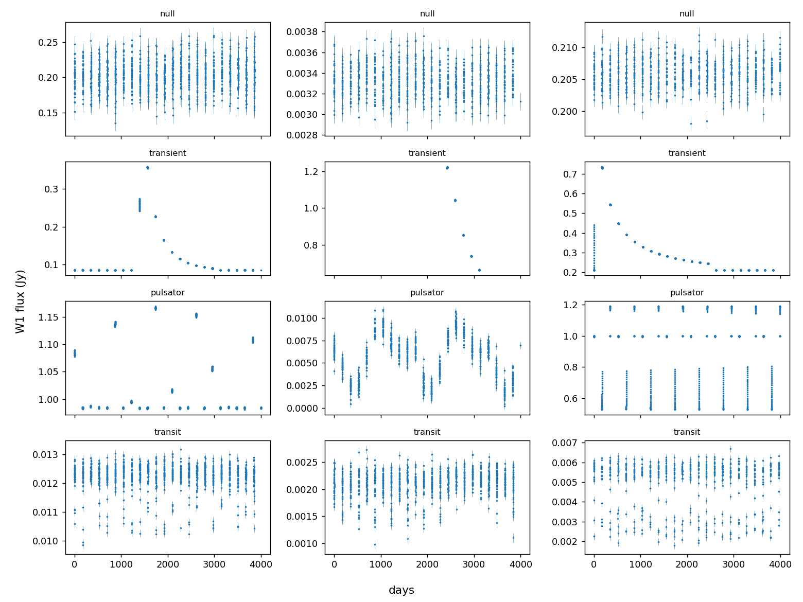
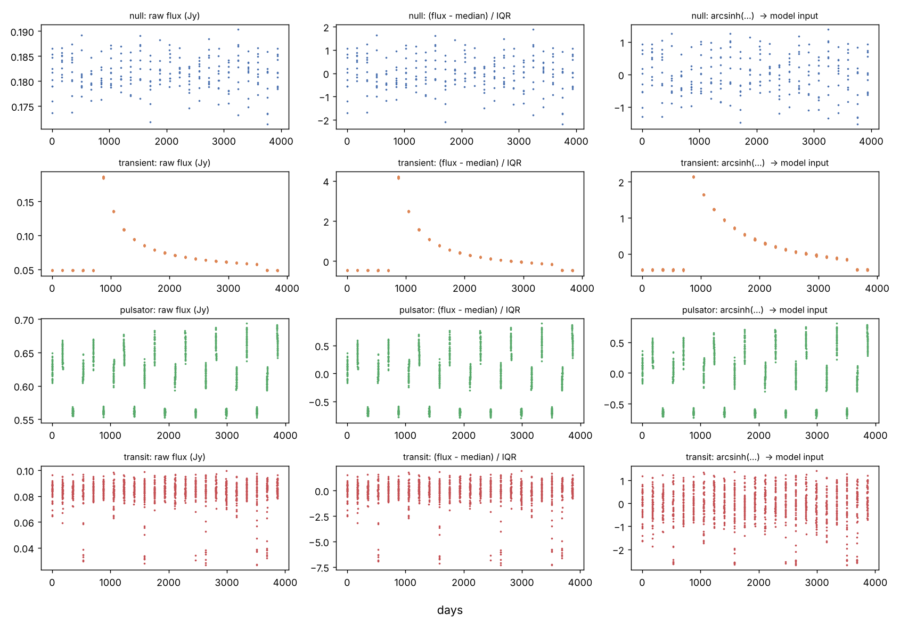
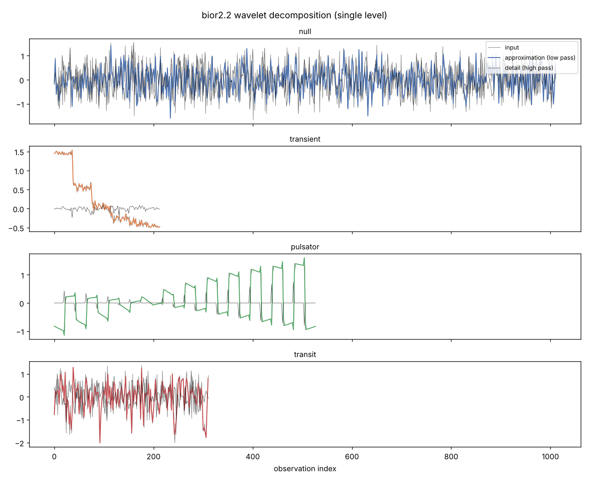
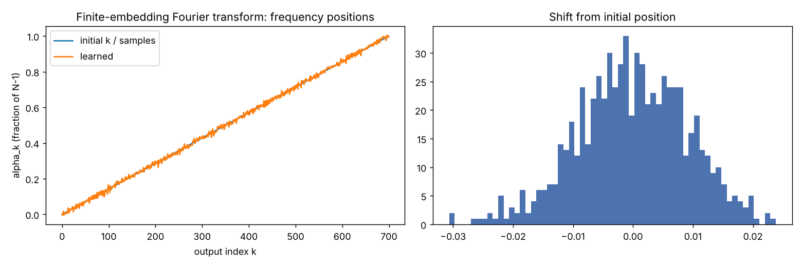
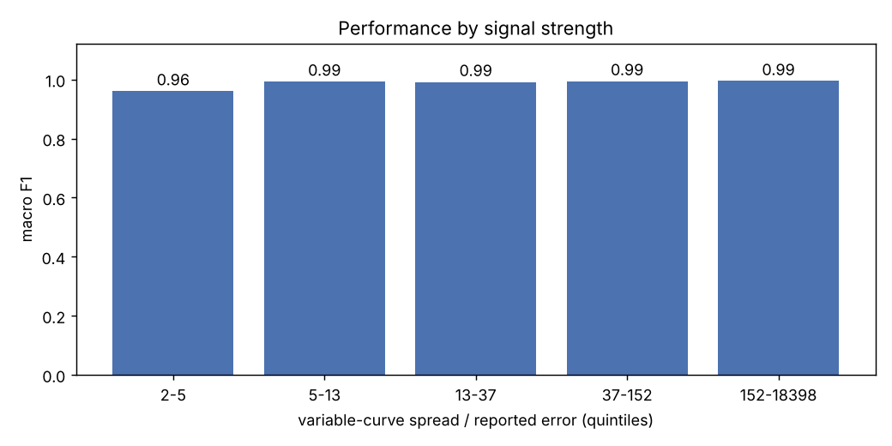
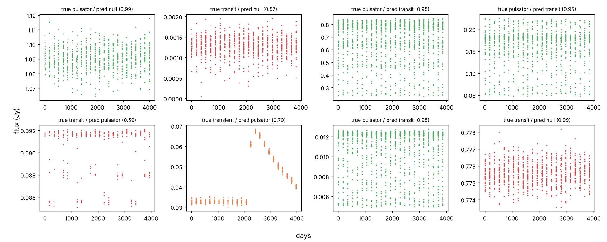
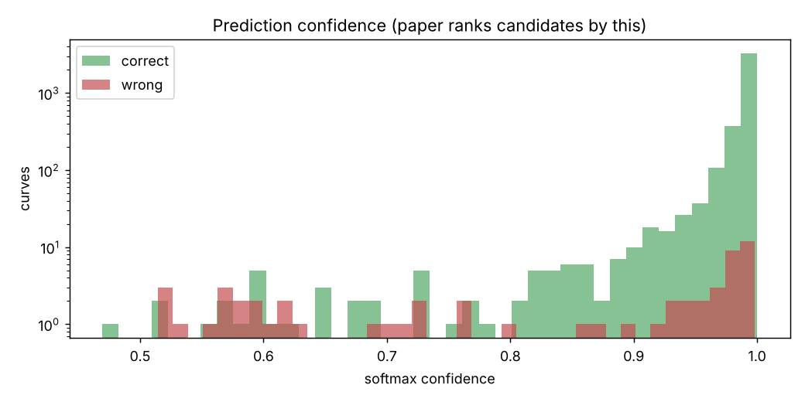

# VARnet Replication — Variable Star Classification from NEOWISE Light Curves

A from-scratch PyTorch reimplementation of:

> M. Paz, "A Submillisecond Fourier and Wavelet-based Model to Extract Variable Candidates from the NEOWISE Single-exposure Database," *The Astronomical Journal* 168:241 (2024). https://doi.org/10.3847/1538-3881/ad7fe6

The paper does not publish code. Everything here is rebuilt from its text, equations and pseudocode (Algorithms 2–6, Figure 8).

## What it does

VARnet classifies a star's infrared brightness over time (a light curve) into four classes:

| Class | Meaning |
|---|---|
| Null | constant source, only noise |
| Transient | one-off brightening (nova, supernova-like) |
| Pulsator | intrinsically varying star (Cepheid, Mira, RR Lyrae…) |
| Transit | eclipsing system |

## Pipeline

1. **Synthetic training data** (`varnet/generator.py`): NEOWISE-like time sampling (groups of 10–50 exposures 0.115 days apart, every ~170 days, over ~4,000 days), plus brightness models for each class. New curves are generated for every batch, so no training example repeats.
2. **Preprocessing** (`varnet/data.py`): flux → `arcsinh((flux − median) / IQR)`, uncertainty → `arcsinh(err / IQR)`, time scaled to [0, 1] (Eqs. 2–5). Each curve becomes a 3 × T tensor, zero-padded per batch.
3. **Model** (`varnet/model.py`):
   - 3 convolution layers
   - bior2.2 discrete wavelet transform (approximation + detail)
   - 3 more convolutions
   - **finite-embedding Fourier transform**, a DFT evaluated at 700 learned frequencies, which turns any length into a fixed-length vector
   - 3 convolutions and 3 fully connected layers to 4 classes
4. **Training** (`train.py`): AdamW, lr 8.5e-5, weight decay 10^-5.5, cross-entropy. Model selection uses macro F1 on a fixed validation set. The final report gives 4-class and real-vs-bogus confusion matrices, macro precision, recall and F1, and inference time per source.

## Run it

```bash
pip install -r requirements.txt
python train.py                 # laptop scale: 25 epochs x 4,000 curves (~100k)
python train.py --paper-scale   # paper scale: 53 epochs x 20,000 curves (1.06M)
```

It uses Apple-silicon GPU (MPS) or CUDA when available. Outputs go to `results/`: `metrics.json`, `history.json`, confusion matrices, training curves, example synthetic curves, and the best model weights.

## Important: how to compare with the paper

The paper's headline numbers (4-class precision 0.918, recall 0.910, **F1 0.914**, accuracy 92.2%; real-vs-bogus F1 0.974) are measured on **231 real NEOWISE sources**. This repository's `train.py` reports metrics on a **held-out synthetic** test set. The two are not the same test. Synthetic scores show the model is implemented correctly and learns. Only a real-source test reproduces the paper's claim. See *Next step*.

## Assumptions where the paper is not specific

Each one is marked `ASSUMPTION` in the code.

- **Time sampling:** the printed pseudocode swaps the 0.115-day and 170-day branches, so the code follows the text instead.
- **Magnitude weighting:** magnitudes are drawn toward the dim end with `m = 16 − 10u²`, and the noise level is drawn log-uniformly.
- **Signal-to-noise:** a minimum signal-to-noise (3σ/flux ≤ 0.5) is applied to **all** classes, so variable classes stay detectable and no class can be recognized by noise level alone.
- **Transient model:** time is measured as a fraction of the event duration.
- **Transit and pulsator shapes:** transits use a trough 2–15% of the period, and pulsators use a Gaussian envelope width in [20, 400] with peaks of random sign.
- **Model details:** convolution kernel size is 5, and the Fourier layer outputs the magnitude of the complex projection.

## Results

**Paper-scale run:** 53 epochs × 20,000 curves = 1,058,304 unique synthetic light curves, trained on an Apple-silicon GPU (MPS). The model was chosen by validation macro F1 (best 0.986) and tested on 4,000 held-out synthetic curves.

| Metric (macro) | This replication (synthetic test) | Paper (231 real sources) |
|---|---|---|
| 4-class precision | 0.988 | 0.918 |
| 4-class recall | 0.988 | 0.910 |
| 4-class F1 | **0.987** | 0.914 |
| 4-class accuracy | 98.8% | 92.2% |
| Real-vs-bogus F1 | 0.991 | 0.974 |
| Real-vs-bogus accuracy | 99.3% | 97.4% |

4-class confusion matrix (rows = true, columns = predicted):

| | Null | Transient | Pulsator | Transit |
|---|---|---|---|---|
| **Null** | 979 | 0 | 0 | 0 |
| **Transient** | 0 | 1023 | 3 | 0 |
| **Pulsator** | 14 | 4 | 1004 | 10 |
| **Transit** | 13 | 0 | 6 | 944 |

**What the results show:**
- **The architecture works as described.** Rebuilt from the paper alone, it learns to separate all four classes, and no constant source was mistaken for a variable.
- **The remaining errors match the paper's.** There are two kinds:
  - faint variables read as constant (27 of 4,000)
  - pulsators and eclipsing systems confused with each other (16)

  The second is the same pulsator/transit ambiguity the paper reports. In `5_misclassified.png`, pulsators with sharp single dips look like eclipses.
- **Performance holds at low signal-to-noise.** Macro F1 is 0.96 in the weakest fifth of signals and 0.99 elsewhere (`4_f1_by_snr.png`).
- **The learned Fourier frequencies move only slightly** from their starting grid, by up to ±0.03 of the spectrum (`3_learned_frequencies.png`). Most of the benefit therefore comes from the fixed-length projection itself rather than from where the frequencies end up.

**Why this score is higher than the paper's:** training and test curves here come from the same generator, so the test is easier than real telescope data. The paper's 0.914 is measured on real sources. These numbers show a correct, working reimplementation, not that it outperforms the original. The real-source test below is what would make the two directly comparable.

Inference speed is not reported from this run, because the original timing code did not wait for the Apple GPU to finish. `train.py` is now fixed, so re-run it to measure speed.

## Charts

### Training and results

| Training curves | 4-class confusion matrix |
|---|---|
|  |  |

| Variable vs. not variable | Example synthetic light curves |
|---|---|
|  |  |

### How the model sees the data

**Preprocessing:** raw flux, then median/IQR scaling, then the arcsinh-compressed input.


**Wavelet decomposition:** the bior2.2 split into a smooth approximation and fast-changing detail.


**Learned Fourier frequencies:** the 700 positions move only slightly (about ±0.03) from their starting grid.


### Error analysis

**Performance by signal strength:** macro F1 is 0.96 on the weakest fifth of signals and 0.99 elsewhere.


**Misclassified curves:** most errors are faint variables read as constant, or pulsators and eclipses confused with each other.


**Confidence** (log scale): correct predictions pile up near 1.0, but some wrong predictions are also very confident (0.95–1.0). Since the paper ranks candidates by confidence, a high score alone doesn't guarantee a correct label.


## Next step: real NEOWISE test set

The paper's validation catalog has 48 eclipsing binaries, 49 pulsators and 34 transients from the GCVS and Koji Mukai's nova list, plus 100 non-variable sources. To reproduce the headline result:

1. Rebuild a catalog in the same proportions.
2. Download W1 single-exposure photometry for each source from NASA/IPAC IRSA, for example with `astroquery.ipac.irsa`.
3. Convert magnitudes with Eq. 1 and preprocess with `varnet.data.preprocess`.
4. Evaluate the saved model.

## Reference

Paz, M. (2024). *The Astronomical Journal*, 168:241. Licensed CC BY 4.0.
